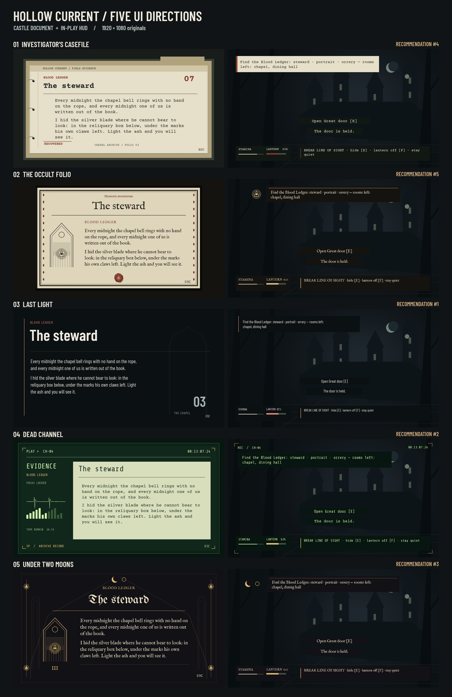

# Hollow Current — five UI directions

Five complete static proposals, 40 original 1920 × 1080 screens, reproducible offline. Prepared against source commit `be4c828022ed7df99d87ba701c75246392140fcf` on `codex/ui-variants`. No C#, scenes, audio, existing handoff or wall-art assets were edited. The previous r13 vellum screen was inspected as variant 0; these are five separate proposals, not an implemented engine UI.

## Recommended order

1. **[Last light](03-last-light/README.md)** — Best overall: the clearest departure from the disliked document card, with the lowest visual load during horror play.
2. **[Dead channel](04-dead-channel/README.md)** — Strongest investigative identity: the instrument framing connects evidence, HUD and failure state across both maps.
3. **[Under two moons](05-two-moons/README.md)** — Strongest castle identity: memorable display type and lunar stonework, with a less natural fit for suburban Bellwether.
4. **[Investigator's casefile](01-casefile/README.md)** — Most practical evidence workflow: excellent transcript clarity, though its bright paper needs a restrained on-screen footprint.
5. **[The occult folio](02-occult-folio/README.md)** — Most diegetic castle document: cohesive ink and wax materials, but closest to the existing vellum direction.

Ranking is a design judgment about this brief, not a user-test result. The owner can select any direction before Unity implementation. Last light is the best starting point for both maps; Dead channel is the strongest alternative if an equipment-led identity is preferred.

## Reproduce and verify

1. Install Python 3.11+ with the versions in `requirements.txt` (use a virtual environment if needed).
2. `python3 render_core.py` regenerates all 40 PNGs, all textures and layout audit logs. Each variation also has its own `render.py` entry point. Rendering is offline and seeded.
3. `python3 package.py` regenerates the style sheets, asset manifests, five review sheets and this comparison.
4. `python3 verify.py` checks dimensions, exact required copy, readable body sizes, contrast, glyph coverage, text intersections, font hashes, licence files and bounded textures; it renders a second time and compares SHA-256 hashes of every generated PNG and audit log.

`fetch_fonts.py` is an optional acquisition tool, not a rendering dependency. It uses the immutable revision in `FONT_SOURCES.json`. All required fonts and their original OFL texts are committed.

## Contents and review limits

Each direction contains the eight requested PNGs, a reproducible entry point, a detailed style sheet, `ASSETS.md`, OFL fonts, six procedural textures, a measurement log and a labelled overview. `CONTACT_SHEET.png` compares each castle document with its in-play HUD; the original full-size screens are the authority for readability.

The 4:3 family photograph is an illustrated placeholder. Scene plates are dark procedural stand-ins, not actual game frames. These are static design proposals: no interaction, Unity font import, performance or dynamic-state test is claimed. All art was drawn procedurally to meet the explicit reproducibility brief; no paid image generation was used. Review and iteration were performed in this Codex session; no separate model critic or unsupported model was claimed.

`QA_REPORT.md` records the final mechanical and visual inspection evidence. `HANDOFF.md` records this task's scoped branch and implementation boundary. Original procedural artwork is CC0-1.0 (`ARTWORK_LICENSE.md`); source scripts/docs use the repository MIT licence; font licences remain OFL-1.1.
